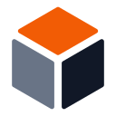
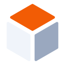
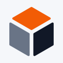
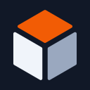

# Logo

The official UnitVectorY-Labs mark is a geometric isometric unit cube constructed from three congruent rhombuses separated by a uniform negative-space **Y**. Four square SVG source assets live in `assets/`—paired transparent standalone marks and boxed avatar marks for light and dark surfaces—alongside a theme-adaptive inline SVG for web application headers.

## Design philosophy

- **Dimensionality and origin.** The isometric unit cube anchors the brand in three-dimensional coordinate space—a quiet nod to the standard physics basis vectors (*î*, *ĵ*, *k̂*) behind the name *UnitVectorY-Labs*, without literal arrows or mathematical lettering.
- **Negative-space Y.** Rather than printing a letterform, the **Y** is carved directly out of the uniform gap between the three faces. It ties the mark to *UnitVectorY* while keeping the silhouette crisp and legible down to `16px` favicon sizes.
- **Signal orange cap.** The top face is rendered in signal orange (`#F25C05`), emphasizing the upward vertical axis and subtly echoing the unit-vector “hat” (*ĵ*) notation.
- **Directional depth and softened vertices.** The two lower faces use two-tone UnitVectorY-Labs blue-slate values—lighter on the left, deeper on the right—to establish top-left lighting and physical volume without gradients or drop shadows. A same-color `stroke-linejoin="round"` subtly softens the 60° polygon vertices so the mark pairs naturally with rounded Tabler outline icons.
- **Square canvas rule.** Every SVG asset ships on a strictly square `100×100` canvas with unrounded corners (no `rx` attribute). Framing such as rounded tiles or circular avatar masks is always applied via CSS (`border-radius`) in the consuming application or platform.

## Official asset variants

Four production SVG files cover every UnitVectorY-Labs surface and platform crop:

<div class="logo-grid">
  <div class="logo-card">
    <div class="logo-stage logo-stage--light">
      
    </div>
    <div class="logo-meta">
      <strong>Standalone — Light</strong>
      <code>assets/uvy-standalone-mark-light.svg</code>
      <span>Transparent background, 88% fill, stroke-width 4. For light UI headers, light READMEs, slides and light favicons.</span>
    </div>
  </div>
  <div class="logo-card">
    <div class="logo-stage logo-stage--dark">
      
    </div>
    <div class="logo-meta">
      <strong>Standalone — Dark</strong>
      <code>assets/uvy-standalone-mark-dark.svg</code>
      <span>Transparent background, 88% fill, stroke-width 4. For dark UI headers, dark READMEs, slides and dark favicons.</span>
    </div>
  </div>
  <div class="logo-card">
    <div class="logo-stage logo-stage--light">
      
    </div>
    <div class="logo-meta">
      <strong>Avatar — Light</strong>
      <code>assets/uvy-avatar-light.svg</code>
      <span>Solid #F5F7FA canvas, 78% fill, 11px optical margin. For light profile avatars, app tiles and circular crops.</span>
    </div>
  </div>
  <div class="logo-card">
    <div class="logo-stage logo-stage--dark">
      
    </div>
    <div class="logo-meta">
      <strong>Avatar — Dark</strong>
      <code>assets/uvy-avatar-dark.svg</code>
      <span>Solid #111827 canvas, 78% fill, 11px optical margin. For GitHub org avatars, registries, dark app icons and circular crops.</span>
    </div>
  </div>
</div>

### Standalone marks (`uvy-standalone-mark-*`)

The standalone variants fill **88%** of the `100×100` viewBox (`stroke-width="4"`) on a transparent background so the cube sits flush with adjacent typography and navigation controls.

- **Use `uvy-standalone-mark-light.svg`** on light surfaces (`#FFFFFF`, `#F5F7FA`)—including light web headers, light-mode READMEs, browser favicons under `prefers-color-scheme: light`, documentation figures and light slides.
- **Use `uvy-standalone-mark-dark.svg`** on dark surfaces (`#090D16`, `#111827`)—including dark web headers, dark-mode READMEs, browser favicons under `prefers-color-scheme: dark` and dark slides.
- **Avoid** placing standalone marks inside tight circular platform avatars where outer edges can clip the 88% cube, or on busy backgrounds where the lower faces lose contrast.

### Avatar marks (`uvy-avatar-*`)

The avatar variants reduce the cube to **78%** of the `100×100` viewBox (`stroke-width="3.5"`) centered inside an **11px optical margin** on a solid square background (`#F5F7FA` light or `#111827` dark).

- **Use `uvy-avatar-dark.svg`** as the primary external identity badge—GitHub organization avatar, container registry icons, Discord/social profiles, dark-themed PWA/app tiles, and any third-party surface whose host background may be light or dark.
- **Use `uvy-avatar-light.svg`** when a light-surface tile is explicitly required—light-mode app launchers, light social/OpenGraph cards, documentation badges or partner directories that expect a bright tile.
- **Why avatars carry a solid canvas and 11px margin:** External platforms frequently apply circular (`border-radius: 50%`) or squircle masks automatically. The optical margin guarantees the cube's six outer vertices never touch or get clipped by any mask.

## When to use each variant

| Context | Recommended asset | Notes |
| --- | --- | --- |
| Web app `.site-header` (`site/uvy.css`) | Inline `<svg class="uvy-mark">` (standalone geometry) | Adapts left/right faces automatically with CSS `light-dark()` when toggling themes |
| Browser tab favicon | `uvy-standalone-mark-light.svg` + `uvy-standalone-mark-dark.svg` | Pair via `<link rel="icon" media="(prefers-color-scheme: ...)">`; crisp at `16px` |
| GitHub README / Markdown header | `uvy-standalone-mark-light.svg` + `uvy-standalone-mark-dark.svg` | Pair inside `<picture>` using `prefers-color-scheme` media queries |
| GitHub org, registry & social avatars | `uvy-avatar-dark.svg` (default) or `uvy-avatar-light.svg` | Built-in `11px` optical margin prevents clipping inside circular masks |
| PWA / Apple touch / launcher icon | `uvy-avatar-dark.svg` or `uvy-avatar-light.svg` | Supply the unrounded square asset; let the OS or CSS apply corner radius |
| Static light document or slide | `uvy-standalone-mark-light.svg` | Transparent backing integrates directly onto white or `#F5F7FA` pages |
| Static dark document or slide | `uvy-standalone-mark-dark.svg` | Transparent backing integrates directly onto `#090D16` or `#111827` slides |

## Color mapping

Every face maps directly to calibrated UnitVectorY-Labs Design colors so the mark harmonizes with light and midnight blue-slate dark interfaces:

| Face / surface | Light mode | Dark mode |
| --- | --- | --- |
| Top face | <span class="color-swatch" style="background:#F25C05" aria-hidden="true"></span> `#F25C05` (`--uvy-accent` light) | <span class="color-swatch" style="background:#F25C05" aria-hidden="true"></span> `#F25C05` (fixed brand orange) |
| Left face (lit) | <span class="color-swatch" style="background:#697486" aria-hidden="true"></span> `#697486` (`--uvy-text-faint`) | <span class="color-swatch" style="background:#F0F4FA" aria-hidden="true"></span> `#F0F4FA` (`--uvy-text`) |
| Right face (shaded) | <span class="color-swatch" style="background:#111827" aria-hidden="true"></span> `#111827` (`--uvy-text`) | <span class="color-swatch" style="background:#9AA8BF" aria-hidden="true"></span> `#9AA8BF` (`--uvy-text-muted`) |
| Background (avatar only) | <span class="color-swatch" style="background:#F5F7FA" aria-hidden="true"></span> `#F5F7FA` (`--uvy-bg`) | <span class="color-swatch" style="background:#111827" aria-hidden="true"></span> `#111827` (`--uvy-surface`) |

The top face holds `#F25C05` in both light and dark modes for cross-surface brand consistency and never changes color on hover.

## Sizing, clear space and CSS framing

- **Standard header size:** Render the standalone mark at `28×28` (`1.75rem`) in `.site-header`, paired with the semibold `--uvy-font-mono` product title separated by `10px` (`0.625rem`).
- **Minimum size:** `16×16` for favicons and compact badges. Do not render smaller than `16px`, where the negative-space Y begins to close.
- **Clear space:** Maintain at least 25% of the mark's width in clear space around standalone placements. Avatar files already bake in an 11% internal margin on all sides.
- **Framing in CSS:** Keep all source SVG files strictly square and control corner rounding in CSS—`0` for crisp square tiles, `var(--uvy-radius-panel)` (`5px`) for panels and tiles, `22%` for app icons, or `50%` for circular avatars:

<div class="uvy-specimen logo-frames">
  <figure>
    
    <figcaption>0px · square</figcaption>
  </figure>
  <figure>
    
    <figcaption>5px · tile</figcaption>
  </figure>
  <figure>
    
    <figcaption>22% · app icon</figcaption>
  </figure>
  <figure>
    
    <figcaption>50% · circle</figcaption>
  </figure>
</div>

## Brand guardrails

- **Do** use the theme-adaptive inline `.uvy-mark` SVG inside UnitVectorY-Labs web applications so the mark responds instantly to the sun/moon theme toggle and `prefers-color-scheme`.
- **Do** pair light variants strictly with light surfaces and dark variants strictly with dark surfaces.
- **Do** keep the exact `100×100` coordinate geometry, uniform negative-space Y and `stroke-linejoin="round"` vertex softening.
- **Do** spell out `UnitVectorY-Labs` in titles, headers and references; never abbreviate the brand to “UVY” in user-facing copy.
- **Don't** change, shift, tint or animate any polygon color of the logo mark on hover—hovering `.brand` leaves `.uvy-mark` completely static.
- **Don't** bake `rx` rounded corners or `<clipPath>` circles into the source SVGs; apply framing in CSS.
- **Don't** recolor the signal-orange top face, swap the left/right lighting direction, or add gradients, outlines or drop shadows.
- **Don't** stretch, rotate or skew the cube, and do not reintroduce the retired literal `ĵ` tile in new or updated applications.

## Implementation snippets

### Theme-adaptive header mark (HTML + `site/uvy.css`)

```html
<a class="brand" href="index.html">
  <svg class="uvy-mark" aria-hidden="true" width="28" height="28" viewBox="0 0 100 100">
    <g stroke-width="4" stroke-linejoin="round">
      <polygon class="uvy-mark__top" points="50,8 82.5,26.75 50,45.5 17.5,26.75" />
      <polygon class="uvy-mark__left" points="12.3,35.75 44.8,54.5 44.8,92 12.3,73.25" />
      <polygon class="uvy-mark__right" points="55.2,54.5 87.7,35.75 87.7,73.25 55.2,92" />
    </g>
  </svg>
  <span>Product Name</span>
</a>
```

### Theme-aware browser favicons

```html
<link rel="icon" type="image/svg+xml" href="assets/uvy-standalone-mark-light.svg" media="(prefers-color-scheme: light)" />
<link rel="icon" type="image/svg+xml" href="assets/uvy-standalone-mark-dark.svg" media="(prefers-color-scheme: dark)" />
```

### Theme-adaptive GitHub README mark

```html
<picture>
  <source media="(prefers-color-scheme: dark)" srcset="assets/uvy-standalone-mark-dark.svg" />
  <source media="(prefers-color-scheme: light)" srcset="assets/uvy-standalone-mark-light.svg" />
  
</picture>
```

See the [logo example](../examples/logo.html) for interactive framing and sizing specimens, and [universal header](header.md) for brand lockup rules.
